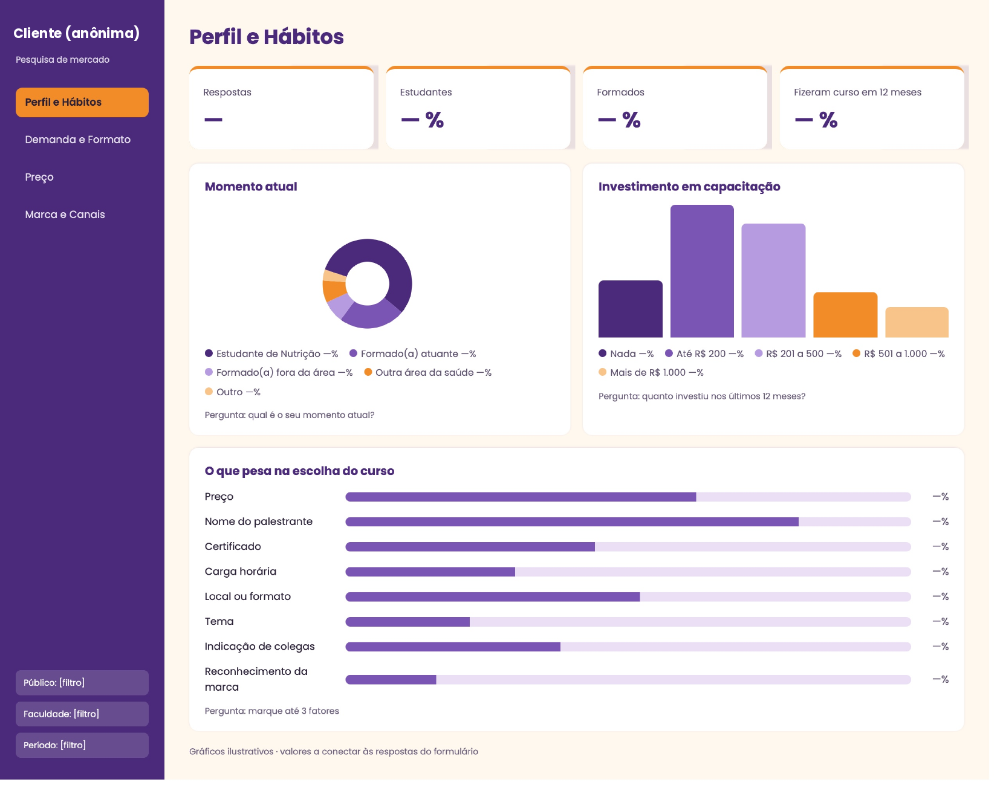
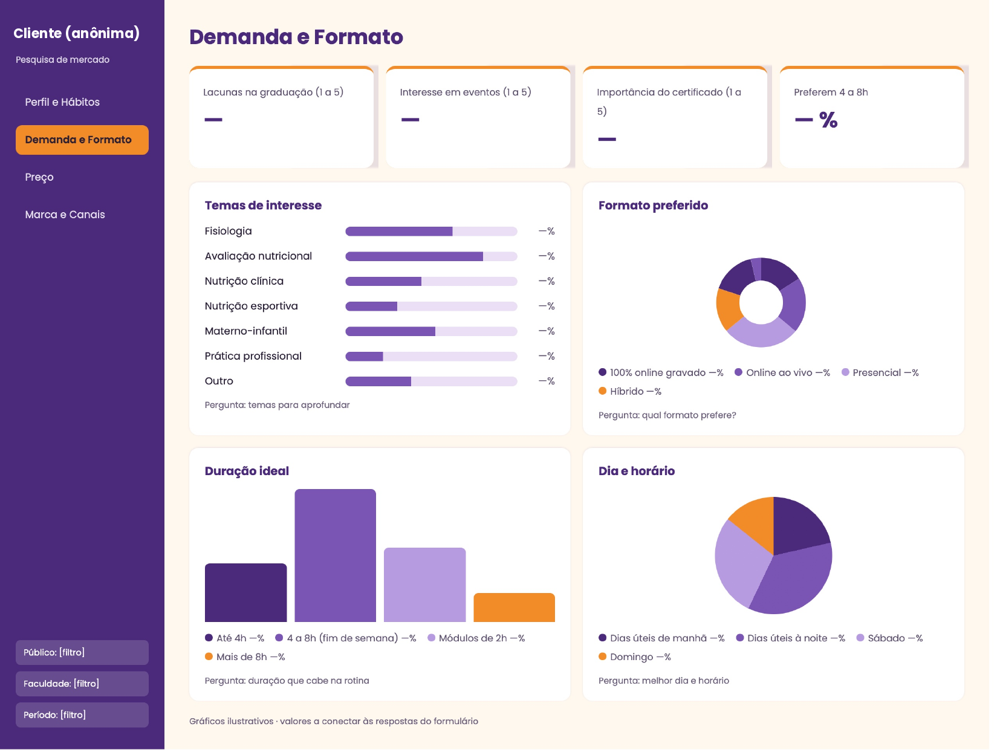
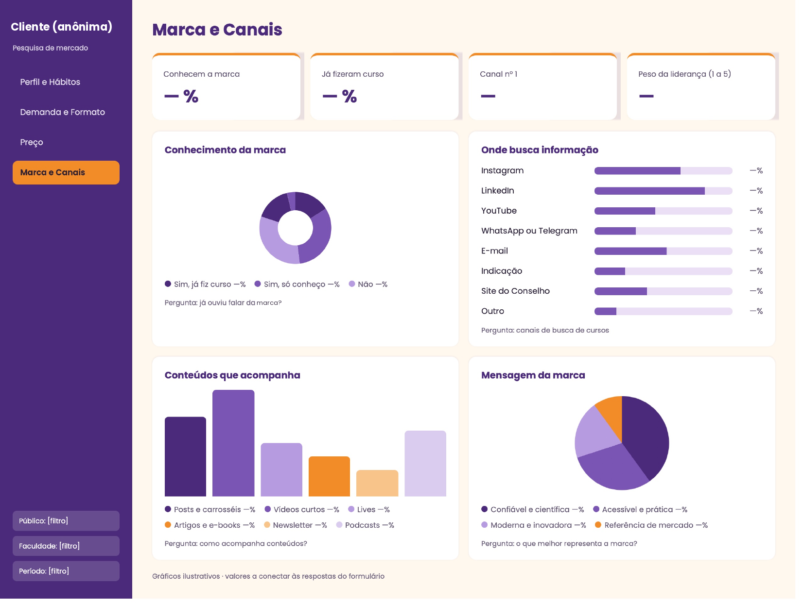

# 📊 Dashboard de Pesquisa de Mercado · Power BI

**Case de consultoria da empresa júnior · Marca de educação continuada em nutrição**

> 🔒 **Confidencialidade:** a cliente é real, então o nome dela foi anonimizado e os dados não aparecem aqui. Os gráficos são **ilustrativos** e mostram só a estrutura do dashboard. A página de Preço ficou de fora por conter informações comerciais.

---

### 🌸 Sobre o projeto

Dashboard criado para analisar as respostas de uma pesquisa de mercado com estudantes e profissionais de Nutrição. O objetivo é apoiar decisões sobre **temas, formato, preço e comunicação** dos cursos da marca.

### 🎀 Estrutura

| Página | O que responde |
|---|---|
| **Perfil e Hábitos** | Quem é o público, quanto investe em capacitação e o que pesa na escolha de um curso |
| **Demanda e Formato** | Lacunas da graduação, temas de interesse, formato, duração e horários preferidos |
| **Preço** | Quanto o público acha justo pagar e como prefere pagar *(não publicada)* |
| **Marca e Canais** | Conhecimento da marca, canais de busca, conteúdos que o público acompanha e percepção da marca |

Filtros globais: **público**, **faculdade** e **período**.

### 🖼️ Prévia

**Perfil e Hábitos**

**Demanda e Formato**

**Marca e Canais**

### ✨ O que pratiquei

- Transformar perguntas de formulário em KPIs e visuais
- Escolher o gráfico certo para cada tipo de pergunta (escala, múltipla escolha, faixas de valor)
- Navegação entre páginas e filtros segmentados
- Identidade visual consistente com a marca da cliente

---

Feito por <a href="https://github.com/vitoriasilva242">Vitória Silva</a> 💜

